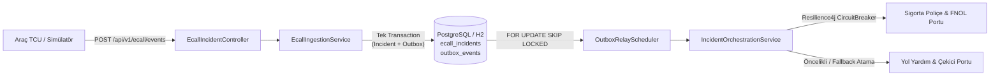

# eCall Crash Detection & Insurance FNOL Orchestrator

Bağlantılı araçlardan (Connected Vehicles) kaza anında gelen **eCall MSD (Minimum Set of Data - EN 15722)** telemetri paketlerini yüksek trafik altında karşılayan, mükerrer (duplicate) sinyalleri filtreleyen ve dış sigorta/yol yardım servisleri çöktüğünde bile veri kaybı yaşamadan çekici ve hasar dosyası (FNOL - *First Notice of Loss*) süreçlerini yöneten Spring Boot 3 uygulaması.

---

## Bu Projeyi Neden Yaptım?

Otomotiv telemetri sistemleri ile sigorta şirketlerinin hasar ihbar (FNOL) servislerinin kesiştiği noktada çok somut bir mühendislik problemi var:

Normal bir günde sistem dakikada sadece birkaç kaza sinyali alır. Ancak **bölgesel bir dolu yağışı, buzlanma veya zincirleme kaza** anında yüzlerce araçtan aynı anda çarpışma paketi gelir. Bu sırada iki şey aynı anda bozulur:
1. Araçların içindeki hücresel modemler (TCU) zayıf şebeke yüzünden `202 Accepted` yanıtını alamaz ve **aynı `eventId` ile aynı kaza paketini 5-10 kez üst üste** gönderir.
2. Arka uçta çağrılan sigorta poliçe doğrulama sistemi aşırı yükten dolayı yavaşlar (2-5 saniye) veya `HTTP 503` dönmeye başlar.

Eğer bu sistemi standart bir senkron CRUD servisi gibi yazarsak; dış sigorta servisi yavaşladığı anda tüm Tomcat thread'leri kilitlenir, veritabanı bağlantı havuzu (HikariCP) dolar ve hava yastığı açılmış acil kaza sinyalleri bile sunucudan geri döner. Ayrıca basit bir `if (!repository.existsByEventId(id))` kontrolü, aynı milisaniyede gelen paralel isteklerde *Race Condition* yüzünden delinir ve aynı araca 3 farklı çekici yönlendirilir.

Bu projede amacım, gereksiz ve karmaşık soyutlamalara girmeden bu üç problemi (**Idempotency, Sıfır Veri Kaybı ve Hata Toleransı**) veritabanı optimizasyonları ve doğru tasarım desenleriyle çözmekti.

---

## Planlama, Tasarım ve Kurumsal Dokümantasyon Süreci

Kodu yazmaya başlamadan önce gereksinimleri ve teknik tasarımı 3 inceleme iterasyonundan (1. Anlaşılabilirlik, 2. Bağlam Uyumu, 3. *Adversarial / Principal Engineer* Eleştirel Bakışı) geçirerek dondurdum (`FROZEN`) ve geliştirmeyi 4 Sprint halinde yürüttüm. Tüm mühendislik belgelerine aşağıdaki bağlantılardan ulaşabilirsiniz:

* **Gereksiyim ve Mimari Tasarım:**
  * [Ürün ve Sistem Gereksinimleri (SPEC.md)](docs/SPEC.md)
  * [Teknik Tasarım ve DB Optimizasyon Dokümanı (TDD.md)](docs/TDD.md)
  * [Spec & TDD 3-İterasyonlu İnceleme Kaydı](docs/reviews/SPEC_TDD_ITERATIONS.md)
* **Sprint Planlama ve Yürütme:**
  * [Sprint Planı ve Çıkış Metrikleri (SPRINT_PLAN.md)](docs/SPRINT_PLAN.md)
  * [Sprint Planı Adversarial İnceleme Kaydı](docs/reviews/SPRINT_PLAN_REVIEW.md)
* **Lokal PoC ve Resmi Test Raporları:**
  * [Lokal PoC ve Mimari Yetkinlik Doğrulama Belgesi (POC_ARCHITECTURE_VALIDATION.md)](docs/POC_ARCHITECTURE_VALIDATION.md)
  * [Test Koşulları ve Ölçüm Sonuçları Raporu (TEST_CONDITIONS_AND_RESULTS.md)](docs/TEST_CONDITIONS_AND_RESULTS.md)

---

## Sistem Mimarisi ve Akış



### Kullandığım Tasarım Desenleri (ve Neden Seçtiğim)

Projede "desen kullanmış olmak için" karmaşık Factory veya çok katmanlı soyutlamalar kullanmadım. Sadece doğrudan bir problemi çözen 4 yapı var:

1. **Transactional Outbox Pattern (`EcallIngestionService` + `OutboxRelayScheduler`):**
   - Kaza verisini veritabanına yazıp hemen ardından ağ üzerinden mesaj kuyruğuna veya dış API'ye gitmeye çalışırsak (*Dual-Write*), ağ koptuğunda veri DB'de kalır ama süreç başlamaz. Bunun yerine `ecall_incidents` ve `outbox_events` kayıtlarını **aynı local transaction** içinde yazıyorum. Ingestion API dış servislerin hızından tamamen bağımsız çalışıyor (`p95 ~15-22ms`).
2. **İki Katmanlı Idempotent Receiver (`EcallIngestionService`):**
   - Ardışık tekrarları hızlıca yakalamak için önce `findByEventId` ile okuma yapıyorum.
   - Ancak aynı milisaniyede gelen paralel istekleri uygulama katmanında durdurmak mümkün olmadığı için asıl korumayı veritabanındaki `UNIQUE (event_id)` indeksine bıraktım. Yazma işlemini `PROPAGATION_REQUIRES_NEW` ile izole bir `TransactionTemplate` içinde çalıştırıyorum; böylece `DataIntegrityViolationException` alan thread zehirlenmiş (`rollbackOnly`) bir Hibernate session'da kalmadan kazanan kaydı okuyup `200 OK (idempotentReplay: true)` dönebiliyor.
3. **Circuit Breaker & Safety-Critical Fallback (`IncidentOrchestrationService`):**
   - Dış sigorta poliçe servisi %50'nin üzerinde hata verdiğinde Resilience4j devreyi `OPEN` konumuna getirir.
   - **Kritik İş Kuralı:** Eğer kaza `CRITICAL` veya `HIGH` seviyesindeyse (örneğin hava yastığı açılmışsa veya $\Delta v \ge 40$ km/s ise), sigorta poliçe sistemi çökmüş olsa bile insan güvenliği gereği çekici/asistans derhal yönlendirilir ve kayıt `DISPATCHED_FALLBACK` olarak işaretlenir. `MODERATE` (düşük hızlı) kazalar ise poliçe servisi düzelene kadar Outbox'ta Exponential Backoff ile bekletilir (`RETRY_SCHEDULED`).
4. **Strategy / Adapter Pattern (`PolicyVerificationPort`, `RoadsideDispatchPort`, `IncidentEventPublisher`):**
   - İş mantığının (`IncidentOrchestrationService`) somut HTTP istemcilerine veya Kafka'ya doğrudan bağımlı olmaması (SOLID - *Dependency Inversion*) için araya sadece tek seviyeli port arayüzleri koydum. Bu sayede canlıya çıkmadan kaos testlerini ve lokal simülasyonları aynı çekirdek kod üzerinde koşturabiliyorum.

---

## Veritabanı Optimizasyonları

Şema tanımlarını [`schema.sql`](src/main/resources/schema.sql) ve üretim PostgreSQL ortamı için [`V1__init_ecall_schema.sql`](src/main/resources/db/migration/V1__init_ecall_schema.sql) içinde görebilirsiniz:

* **Outbox Tarama Darboğazını Önleyen Partial / Composite İndeks:**
  Outbox tablosunda zamanla milyonlarca `PROCESSED` satır birikir. Poller her 150ms'de bir çalıştığında *Full Table Scan* yapmaması için `(status, next_attempt_at, created_at)` bileşik indeksi ve PostgreSQL için `WHERE status = 'PENDING'` **Partial Index** tanımlandı. Böylece indeks boyutu sadece işlenmeyi bekleyen kayıtlarla sınırlı kalır.
* **Çoklu Sunucu (Multi-Instance) Çakışmasını Önleyen `FOR UPDATE SKIP LOCKED`:**
  Uygulama birden fazla pod/instance olarak çalıştığında iki sunucunun aynı Outbox satırını okuyup aynı kazayı iki kez işlememesi için [`OutboxEventRepository`](src/main/java/com/automotive/ecall/domain/OutboxEventRepository.java) içindeki sorgu `FOR UPDATE SKIP LOCKED` kullanır.
* **Optimistic Locking (`@Version`) ve `open-in-view: false`:**
  `ecall_incidents` üzerindeki eşzamanlı durum güncellemelerinde *Lost Update* yaşanmaması için `@Version` kullanıldı. Ayrıca veritabanı bağlantılarının HTTP yanıtı dönene kadar gereksiz yere tutulmasını önlemek için `spring.jpa.open-in-view: false` olarak kapatıldı.

---

## Geliştirme Sırasında Karşılaştığım Sorunlar ve Dürüst Öz Değerlendirme

### 1. Yakaladığım `@Transactional` (`UnexpectedRollbackException`) Tuzağı
Sprint 2'de `MODERATE` şiddetli kazaların retry mekanizmasını test ederken ilginç bir hata aldım: Sigorta servisi `HTTP 503` döndüğünde `IncidentOrchestrationService` olayı `RETRY_SCHEDULED` olarak kaydedip hatayı `OutboxRelayScheduler`'a yeniden fırlatıyordu. Ancak Spring'in varsayılan `@Transactional` yapısı metottan `RuntimeException` çıktığını görünce dış transaction'ı `rollbackOnly` olarak işaretledi ve commit anında `UnexpectedRollbackException` fırlattı.  
**Çözüm:** `@Transactional(noRollbackFor = {ExternalServiceException.class, CallNotPermittedException.class})` tanımlayarak, beklenen dış servis kesintilerinde hem `RETRY_SCHEDULED` durumunun hem de Outbox `next_attempt_at` güncellemesinin rollback olmadan commit edilmesini sağladım.

### 2. Bilinen Kısıtlar ve Gelişime Açık Yanlar (Known Limitations)
Projeyi incelerken abartılı iddialarda bulunmak yerine mevcut sınırları açıkça belirtmek isterim:
* **Batching Optimizasyonu Temel Düzeyde:** `OutboxRelayScheduler` şu an bekleyen kayıtları `LIMIT 50/100` gruplar halinde tek sorguda çekiyor (`SKIP LOCKED`), ancak döngü içinde her olayı işledikten sonra durumu tekil JPA `save()` çağrılarıyla güncelliyor. Saniyede 20.000+ olayın aktığı bir ortamda bu yaklaşım ağ git-gel (round-trip) maliyeti yaratacaktır; orada doğrudan `JdbcTemplate.batchUpdate()` veya Hibernate batch rewrite ayarlarına geçilmesi gerekir.
* **Polling vs CDC:** Altyapıyı anlaşılır tutmak için Outbox tablosunu `@Scheduled` poller ile okudum. Çok daha büyük ölçekte veritabanına sürekli polling sorgusu atmak yerine PostgreSQL WAL loglarını **Debezium (CDC)** ile okuyup Kafka'ya aktarmak daha doğru bir yaklaşım olurdu.

---

## Lokal PoC ve Ölçüm Sonuçları Özeti

[`LocalHighLoadPocBenchmarkTest`](src/test/java/com/automotive/ecall/poc/LocalHighLoadPocBenchmarkTest.java) ile alınan gerçek ölçüm sonuçları (detaylar [TEST_CONDITIONS_AND_RESULTS.md](docs/TEST_CONDITIONS_AND_RESULTS.md) belgesindedir):

| Senaryo | Gönderilen Paket | Tekil / Mükerrer | Karşılama Hızı | p50 / p95 Gecikme | Sonuç & Devre Kesici Durumu |
| :--- | :--- | :--- | :--- | :--- | :--- |
| **Senaryo A:** Bölgesel Kaza Fırtınası (Sağlıklı Dış Servis) | 650 Paket (24 Thread) | 500 Tekil + 150 Mükerrer | **2,698 req/sn** | **4.74 ms / 22.92 ms** | 500 `DISPATCHED_COMPLETE`, 150 Mükerrer Engellendi, `0` Hata (`CB: CLOSED`) |
| **Senaryo B:** Sigorta API Çöküşü (`150ms` Gecikme + `%100 HTTP 503`) | 360 Paket (24 Thread) | 300 Tekil + 60 Mükerrer | **3,864 req/sn** | **2.36 ms / 15.72 ms** | `CB: OPEN`, 250 Kritik Kazaya Acil Çekici (`DISPATCHED_FALLBACK`), 50 `RETRY_SCHEDULED` |

---

## Kurulum ve Çalıştırma

### 1. Testleri ve Yüksek Yük PoC Benchmark'ını Çalıştırma
Proje varsayılan olarak PostgreSQL uyumluluk modundaki (`MODE=PostgreSQL`) gömülü veritabanı ile sıfır dış bağımlılıkla çalışır:
```bash
mvn clean test
```
Testler tamamlandığında `target/poc-benchmark-results.json` dosyasında lokal yük testinin ham çıktılarını görebilirsiniz.

### 2. Uygulamayı Ayağa Kaldırma
```bash
mvn spring-boot:run
```
veya PostgreSQL 16 + Apache Kafka container'ları ile çalıştırmak için:
```bash
docker compose up --build
```

### 3. Örnek API Çağrıları (cURL)

**A) Tekil eCall Çarpışma Paketi Gönderme (`POST /api/v1/ecall/events`):**
```bash
curl -i -X POST http://localhost:8080/api/v1/ecall/events \
  -H "Content-Type: application/json" \
  -d '{
    "eventId": "ECALL-2026-9001",
    "vin": "W1K2050401F123456",
    "crashTimestamp": "2026-11-17T11:30:00Z",
    "impactDeltaV": 46.5,
    "airbagDeployed": true,
    "rolloverDetected": false,
    "latitude": 41.0082,
    "longitude": 28.9784,
    "headingDegrees": 140,
    "passengersCount": 2
  }'
```
*(İlk çağrıda `HTTP 202 Accepted` ve `"idempotentReplay": false` döner; aynı komutu tekrar çalıştırdığınızda `HTTP 200 OK` ve `"idempotentReplay": true` döner.)*

**B) Dış Sigorta Servisine Kaos / Hata Enjekte Etme (`POST /api/v1/simulation/chaos`):**
```bash
curl -X POST http://localhost:8080/api/v1/simulation/chaos \
  -H "Content-Type: application/json" \
  -d '{
    "artificialLatencyMs": 200,
    "failureRatePercent": 100,
    "resetCircuitBreaker": true
  }'
```

**C) Filo Kaza Fırtınası Simülasyonu Başlatma (`POST /api/v1/simulation/burst`):**
```bash
curl -X POST http://localhost:8080/api/v1/simulation/burst \
  -H "Content-Type: application/json" \
  -d '{
    "uniqueVehicles": 200,
    "duplicatePackets": 50,
    "concurrencyThreads": 16,
    "drainOutboxImmediately": true
  }'
```

**D) Canlı Sistem ve Circuit Breaker İstatistiklerini Sorgulama (`GET /api/v1/ecall/stats`):**
```bash
curl http://localhost:8080/api/v1/ecall/stats
```
