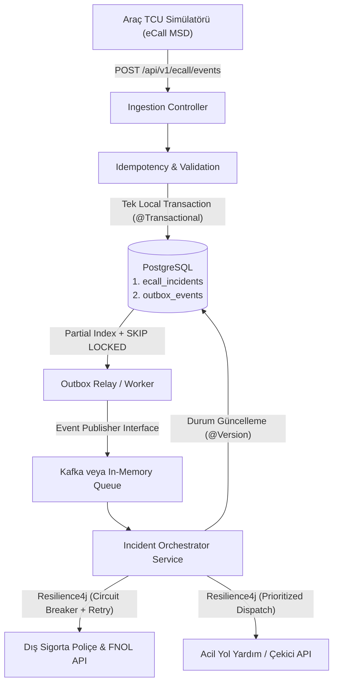

# Teknik Tasarım Dokümanı (TDD)
**Proje:** Bağlantılı Araç Çarpışma Algılama (eCall) ve Otomatik Hasar/Asistans Orkestratörü  
**Doküman Durumu:** `FROZEN (v1.0 - İterasyon 3 Onaylı)`  
**Teknoloji Yığını:** Java 17, Spring Boot 3.x, Spring Data JPA / JDBC, Flyway, PostgreSQL (veya H2 PostgreSQL-uyumlu mod), Apache Kafka (opsiyonel profil), Resilience4j, Micrometer, JUnit 5

---

## 1. Mimari Genel Bakış (High-Level Architecture)

Sistem, gereksiz mikroservis karmaşasından (dağıtık monolit tuzağından) kaçınmak amacıyla **İyi Sınırlandırılmış Modüler Servis (Modular Monolith / Event-Driven Worker)** yapısında tasarlanmıştır. İstenildiğinde Ingestion ve Orchestrator katmanları ayrı container'lar olarak ölçeklenebilir.



---

## 2. Neden Bu Tasarım Desenlerini (Design Patterns) Seçtik?

Mülakatlarda *"Neden burada X desenini kullandın?"* sorusuna ezbere değil, somut mühendislik problemi üzerinden yanıt verebilmek için projede **sadece 4 temel desen** kullanılmış, gereksiz Factory/Builder/Generic soyutlamalarından kaçınılmıştır:

### 2.1. Transactional Outbox Pattern
- **Çözdüğü Problem:** Kaza verisini PostgreSQL'e kaydettikten hemen sonra doğrudan Kafka'ya veya dış servise göndermeye çalışırsak (*Dual-Write*), veritabanı commit'i başarılı olup ağ/Kafka hatası yaşandığında kaza kaydı DB'de `RECEIVED` olarak kalır ama hiçbir zaman çekici veya hasar süreci başlamaz.
- **Uygulama Şekli:** `EcallIngestionService` aynı `@Transactional` metot içinde hem `ecall_incidents` tablosuna hem de `outbox_events` tablosuna kayıt atar. İkisi birlikte commit edilir veya birlikte rollback olur.

### 2.2. Strategy / Adapter Pattern (`EventDispatcherPort`)
- **Çözdüğü Problem:** Uygulamanın kurumsal ortamda **Apache Kafka** ile, yerel geliştirme veya hızlı PoC ortamında ise harici bir broker kurulumuna ihtiyaç duymadan **In-Memory / Spring ApplicationEvent** ile birebir aynı iş mantığını çalıştırabilmesi gerekir.
- **Uygulama Şekli:** Tek bir `IncidentEventPublisher` arayüzü (interface) tanımlanmıştır. `@Profile("kafka")` aktifken `KafkaIncidentEventPublisher`, varsayılan profilde ise `LocalAsyncIncidentEventPublisher` devreye girer (SOLID - *Dependency Inversion* ve *Open/Closed Principle*).

### 2.3. Circuit Breaker & Fallback Pattern (Resilience4j)
- **Çözdüğü Problem:** Zincirleme kaza veya fırtına anında sigorta şirketinin eski (legacy) poliçe sorgulama sistemi 5 saniye gecikmeye veya `HTTP 503` dönmeye başlar. Eğer her kaza olayında bu servisi 5 saniye beklersek tüm worker thread'lerimiz kilitlenir (*Cascading Failure*) ve acil çekici/ambulans bekleyen araçlara bile yanıt veremeyiz.
- **Uygulama Şekli:** Poliçe servisi çağrısı `@CircuitBreaker` ile sarılmıştır. Hata oranı %50'yi geçtiğinde devre açılır (*OPEN*), sigorta servisine gitmek yerine 0ms'de `fallbackVerifyPolicy` metoduna düşer. Eğer kaza `CRITICAL` ise poliçe doğrulaması sonraya bırakılarak (`DISPATCHED_FALLBACK`) çekici derhal yönlendirilir.

### 2.4. Idempotent Receiver Pattern
- **Çözdüğü Problem:** Araç içindeki TCU modemi, tünel veya kırsal alanda `202 Accepted` yanıtını alamazsa aynı `eventId`'li paketi 5 kez üst üste gönderir.
- **Uygulama Şekli:** Önce hızlı okuma (`findByEventId`) yapılır; ancak yüksek eşzamanlılıkta (aynı milisaniyede gelen 2 istek) uygulama seviyesindeki `if` kontrolü yetersiz kalacağı için veritabanı seviyesinde `UNIQUE (event_id)` kısıtı ile korunur. `DataIntegrityViolationException` yakalanırsa mevcut kayıt bulunup `idempotentReplay: true` olarak dönülür.

---

## 3. Veritabanı Şeması ve Optimizasyon Kararları (DB Optimizations)

Veritabanı katmanı bu projenin **en güçlü kaslarından biri** olarak tasarlanmıştır. Şema `Flyway` (`V1__init_ecall_schema.sql`) ile yönetilir.

### 3.1. `ecall_incidents` Tablosu
```sql
CREATE TABLE ecall_incidents (
    id BIGSERIAL PRIMARY KEY,
    event_id VARCHAR(64) NOT NULL,
    vin VARCHAR(17) NOT NULL,
    crash_timestamp TIMESTAMP WITH TIME ZONE NOT NULL,
    impact_delta_v DOUBLE PRECISION NOT NULL,
    airbag_deployed BOOLEAN NOT NULL,
    rollover_detected BOOLEAN NOT NULL,
    latitude DOUBLE PRECISION NOT NULL,
    longitude DOUBLE PRECISION NOT NULL,
    heading_degrees INTEGER NOT NULL,
    passengers_count INTEGER NOT NULL,
    severity VARCHAR(20) NOT NULL,
    status VARCHAR(32) NOT NULL,
    policy_number VARCHAR(40),
    claim_reference VARCHAR(40),
    dispatch_reference VARCHAR(40),
    failure_reason VARCHAR(500),
    retry_count INTEGER NOT NULL DEFAULT 0,
    version BIGINT NOT NULL DEFAULT 0,
    created_at TIMESTAMP WITH TIME ZONE NOT NULL DEFAULT CURRENT_TIMESTAMP,
    updated_at TIMESTAMP WITH TIME ZONE NOT NULL DEFAULT CURRENT_TIMESTAMP,
    CONSTRAINT uq_ecall_incidents_event_id UNIQUE (event_id)
);
```

### 3.2. `outbox_events` Tablosu
```sql
CREATE TABLE outbox_events (
    id BIGSERIAL PRIMARY KEY,
    aggregate_id VARCHAR(64) NOT NULL, -- event_id
    event_type VARCHAR(50) NOT NULL,
    payload TEXT NOT NULL,
    status VARCHAR(20) NOT NULL DEFAULT 'PENDING',
    retry_count INTEGER NOT NULL DEFAULT 0,
    next_attempt_at TIMESTAMP WITH TIME ZONE NOT NULL DEFAULT CURRENT_TIMESTAMP,
    created_at TIMESTAMP WITH TIME ZONE NOT NULL DEFAULT CURRENT_TIMESTAMP,
    processed_at TIMESTAMP WITH TIME ZONE
);
```

### 3.3. Kritik İndeks ve Kilitleme (Locking) Stratejileri
1. **Race-Condition Korumalı Tekillik (`uq_ecall_incidents_event_id`):**
   - `event_id` üzerindeki `UNIQUE` B-Tree indeksi hem $O(\log N)$ karmaşıklığında tekillik sorgusu sağlar hem de eşzamanlı iki thread'in aynı kazayı çift kaydetmesini DB motoru seviyesinde engeller.
2. **Outbox Tarama Darboğazını Önleyen İndeks (`idx_outbox_poll`):**
   - Outbox tablosunda zamanla milyonlarca `PROCESSED` satır birikir. Poller her 200ms'de bir çalıştığında tüm tabloyu taramaması (Full Table Scan önleme) için `(status, next_attempt_at, created_at)` üzerinde bileşik indeks (ve PostgreSQL ortamında `WHERE status = 'PENDING'` Partial Index) kullanılır.
3. **Çoklu Sunucu Çakışmasını Önleyen `FOR UPDATE SKIP LOCKED`:**
   - Uygulama 3 kopya (instance) olarak çalıştığında, Outbox Poller'ların aynı satırı okuyup aynı kazayı 3 kez işlememesi için:
     ```sql
     SELECT * FROM outbox_events
     WHERE status = 'PENDING' AND next_attempt_at <= CURRENT_TIMESTAMP
     ORDER BY created_at ASC
     LIMIT 50
     FOR UPDATE SKIP LOCKED
     ```
   - Bu sorgu sayesinde 1. sunucunun kilitlediği 50 satırı 2. sunucu beklemeden atlar (`SKIP LOCKED`) ve sıradaki 50 satırı alır.
4. **Optimistic Locking (`@Version`):**
   - `ecall_incidents` tablosundaki `version` alanı sayesinde, bir olay üzerinde aynı anda iki farklı güncelleme yapılmaya çalışılırsa *Lost Update* (veri ezilmesi) yaşanmaz; `ObjectOptimisticLockingFailureException` fırlatılır.
5. **VIN + Zaman Sorguları İçin Bileşik İndeks (`idx_incidents_vin_time`):**
   - Sigorta şirketinin bir aracın geçmiş kazalarını sorgulaması için `(vin, crash_timestamp DESC)` bileşik indeksi tanımlanmıştır.

---

## 4. Paket Yapısı ve SOLID İlkeleri

Aşırı soyutlamadan kaçınan, stajyer/junior bir mühendisin rahatlıkla hakim olup anlatabileceği **Özellik Odaklı Katmanlı Yapı (Feature-Aligned Clean Architecture)**:

```text
com. automotive.ecall
 ├── api                  # REST Controller, Request/Response DTO, GlobalExceptionHandler
 ├── domain               # Entity (EcallIncident, OutboxEvent), Enum (SeverityLevel, IncidentStatus), Repository
 ├── service              # İş mantığı: EcallIngestionService, IncidentOrchestrationService, SeverityCalculator
 ├── outbox               # OutboxRelayScheduler, IncidentEventPublisher (Interface + Kafka/Local impl)
 ├── integration          # Dış servis istemcileri: InsurancePolicyClient, RoadsideAssistanceClient (+ Mock/Simülasyon)
 └── config               # Resilience4j, Async ThreadPool, OpenAPI / Actuator ayarları
```

- **Single Responsibility (SRP):** `SeverityCalculator` sadece darbe şiddeti hesaplar; `EcallIngestionService` sadece doğrulama ve atomik kayıt yapar; `IncidentOrchestrationService` sadece dış servis akışını yönetir.
- **Open/Closed (OCP):** Yeni bir mesaj kuyruğu (örn. RabbitMQ) eklemek için mevcut orkestrasyon koduna dokunulmaz, sadece `IncidentEventPublisher` implemente edilir.
- **Dependency Inversion (DIP):** Orkestrasyon servisi somut HTTP istemcilerine değil, `PolicyVerificationPort` ve `RoadsideDispatchPort` arayüzlerine bağımlıdır.

---

## 5. Bilinen Kısıtlar ve Gelişime Açık Alanlar (Known Limitations & Honest Trade-offs)

> *Not: Bu bölüm, sistemin mevcut sınırlarını ve gerçek bir üretim ortamına geçerken hangi ileri seviye optimizasyonların eklenmesi gerektiğini dürüstçe belgelemek için yazılmıştır.*

1. **Outbox Okuma ve Yazma Batching Seviyesi:**
   - Mevcut yapıda Outbox Poller her döngüde `LIMIT 50` kayıt çekmekte, ancak her bir olayı işlerken durum güncellemelerini tekil JPA `save()` çağrılarıyla yapmaktadır. Çok daha yüksek ölçeklerde (örn. >20.000 olay/sn) Hibernate `jdbc.batch_size` optimizasyonu veya doğrudan `JdbcTemplate.batchUpdate()` ile toplu durum güncellemesi yapılması gerekecektir.
2. **CDC (Change Data Capture) Yerine Polling Kullanımı:**
   - Anlaşılabilirliği korumak ve altyapı bağımlılığını azaltmak adına Outbox tablosu Scheduled Polling ile okunmaktadır. Ultra düşük gecikme (<5ms) gereken kurumsal ortamlarda Polling yerine **Debezium (Kafka Connect)** ile PostgreSQL WAL loglarının okunması daha verimli bir alternatiftir.
3. **Dış Servis Mutabakatı (Reconciliation Job):**
   - `DISPATCHED_FALLBACK` durumuna düşen (acil çekici gönderilmiş ancak sigorta poliçe servisi kapalı olduğu için FNOL açılamamış) kayıtlar şu an veritabanında işaretlenmektedir; bunları gece toplu olarak sigorta sistemine tekrar soran ayrı bir *Batch Reconciliation* işi ilk faz kapsamı dışında tutulmuştur.
